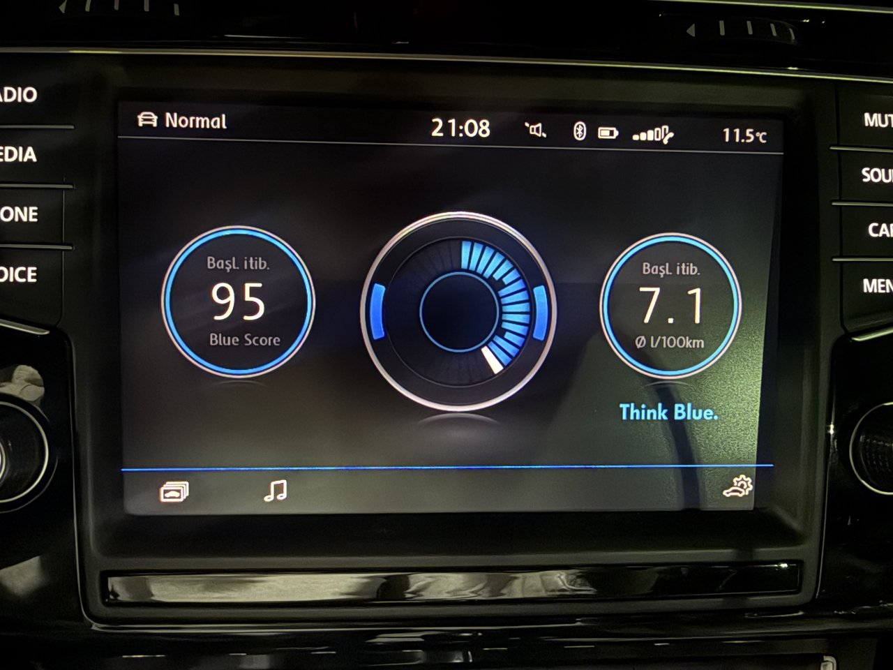

# MIB2 Think Blue Trainer

**Experimental v0.1.0 prerelease. The preparation installer has not been tested on Windows or against a live head unit.** It prepares a repair file for the reviewed Delphi 874B head unit with software train `MST2_EU_VW_P0635D` and MU `0757`. In-car activation still requires a tested way to load the repair at startup.



*Think Blue Trainer on the project car during earlier development.*

Think Blue starts with defaults from the firmware. A valid but entirely zero-filled 102-byte `EcoHmi` block can overwrite them. The overlay treats the known fields of that exact blank block as absent when the Trainer reads it, so the firmware keeps its original defaults. Nonblank configurations pass through unchanged. The Trainer continues to select its own scoring table and use the car's live signals. The Offroad and Trainer menu settings are separate from this repair.

## Choose a profile

| Builder option | Powertrain and gearbox detected by the firmware |
| --- | --- |
| `auto` | Any of the supported combinations below |
| `combustion-manual` | Combustion with a manual gearbox |
| `combustion-automatic` | Combustion with an automatic gearbox, including both Tiptronic states |
| `hybrid-manual` | Plug-in hybrid with a manual gearbox, if classified that way by the firmware |
| `hybrid-automatic` | Plug-in hybrid with an automatic gearbox, including both Tiptronic states |
| `electric` | Battery electric |

The selection is a compatibility check. When it differs from the native classification, the original `EcoHmi` response goes through unchanged. A plug-in hybrid uses the native combustion gearbox table and retains the firmware's hybrid history settings.

## Prepare the repair

Download and extract the installer ZIP. Use Python 3.10 or later and a Java runtime that can run Eclipse ECJ 4.6.1. Double-click `Install.cmd` on Windows or run `python install.py`. The wizard asks for your vehicle type and the IP shown in the head unit’s service menu. It offers `192.168.1.4` as the default. [GitHub prerelease](https://github.com/Victor-Unsullied/mib2-bluetrainer/releases/tag/v0.1.0)

- **Read from your own head unit.** Check the **D-Link DUB-E100** label, use the direct wired connection, and select **Read them from the head unit**. Use its existing FTP account with read permission for `/ifs1/MIBHMI.jxe` and `/extbin/apps/J9/lib/jclFoundation11/classes.zip`. The wizard reads those two files and verifies their checksums. The FTP password is entered privately and sent over the direct cable using the unit’s FTP service.
- **Use a local backup.** Put your `MIBHMI.jxe` and `classes.zip` alongside `install.py` or choose a folder containing both. You can also use `MIBHMI-analysis.jar` with the matching `j9-foun11-classes.zip` from a prior preparation.

When preparing a raw JXE for the first time, the wizard downloads six Python files from a fixed `jxe2jar` revision and checks each file’s SHA-256 before running it. It verifies the resulting HMI classes individually so differences in JAR timestamps are accepted. An existing `jxe-converter` folder or an explicit `--converter PATH` can still be used. [Reviewed jxe2jar revision](https://github.com/luka-dev/jxe2jar/tree/9eeb45bbf14bf8afe3452c7be96a4d1f0206a286/src)

If `ecj-4.6.1.jar` is missing, the wizard also downloads and verifies the Eclipse compiler. An internet connection is needed for any tools that have yet to be downloaded. [Eclipse compiler on Maven Central](https://repo.maven.apache.org/maven2/org/eclipse/jdt/core/compiler/ecj/4.6.1/ecj-4.6.1.jar)

```powershell
python install.py --check
python install.py --plan
python install.py --inspect
python install.py --rollback
```

`--check --inputs PATH` checks an existing set of prepared build files offline. The wizard saves newly prepared references under `private/references/`, and the repair file and its checksum receipt in `private/prepared/`. `--inspect` checks that the saved repair matches the receipt. `--rollback` moves that repair and its receipt to a local archive folder. Keep these folders private and use the same `--state-dir` each time.

The direct builder remains available for scripted builds.

```text
python build_overlay.py --profile auto --compiler path/to/ecj-4.6.1.jar --bootclasses path/to/j9-foun11-classes.zip --hmi-api path/to/MIBHMI-analysis.jar --output thinkblue-overlay.jar
```

The resulting JAR contains the patched Trainer class derived from your firmware and two small helper classes. Keep that JAR and the firmware files local. Vehicle activation and recovery need a validated early HMI loader. The stock HMI comes before the Sport Gauges carrier on the boot classpath. Live FTP access, native QNX/J9 loading and in-car scoring for this preview remain unverified.

The earlier R5 repair restored live scoring in a separate manual-transmission vehicle trial. The profile selection and blank-configuration behavior of this preview have been checked on a desktop JVM.

## Tests

```text
python -B -m unittest discover -s tests -v
```

For the optional desktop Java audit with your own reference JAR, see [tests/README.md](tests/README.md).

Use **Bug report** for offline tool problems or **Compatibility / support request** for firmware and vehicle questions. Include the project version, selected profile, head-unit model, Train and MU. Keep factory files, backups and identifiers private. [Open an issue](https://github.com/Victor-Unsullied/mib2-bluetrainer/issues/new/choose)
